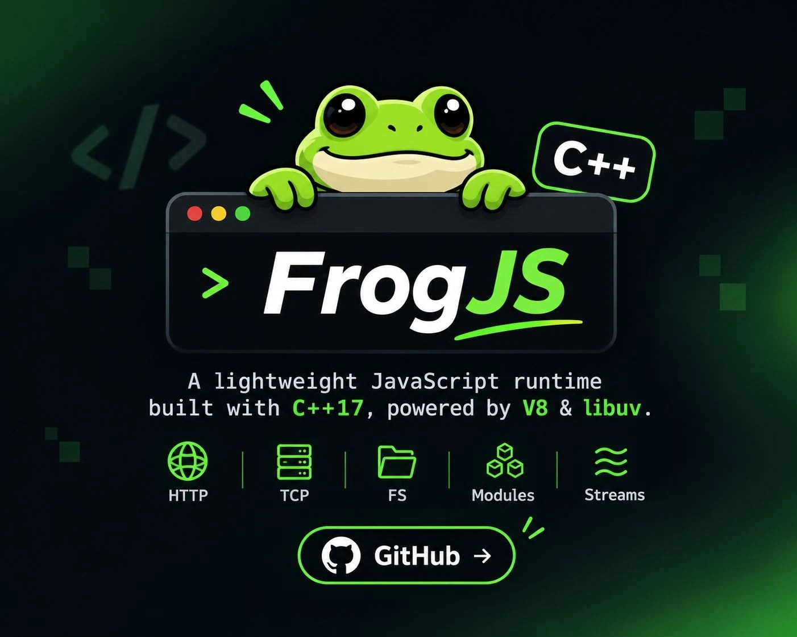

  

<h2 align="center">Hi, I'm Minjurul 🐸</h2>

  <b>Senior Backend Engineer</b> · Node.js · TypeScript · AWS 
  📍 Kuala Lumpur, Malaysia

  
  
  
  
  

---

### 👋 About me

I build backend systems that stay fast and boring under load: microservices, APIs and event-driven pipelines. 5+ years of shipping production code with Node.js, TypeScript and AWS, for teams in Sweden and Bangladesh.

- ⚡ Cut API response times from **450ms → 180ms** with Redis caching and PostgreSQL tuning
- 🏗️ Architected a microservices platform on **NestJS + RabbitMQ**
- 🐸 Building **[FrogJS](https://github.com/dev-frog/frogJs)**, my own JavaScript runtime, from scratch in C++
- 🛡️ CTF player · **1st runner-up**, national Cyber Security Challenge, Bangladesh (2018)

### 🐸 Featured project: FrogJS

A JavaScript runtime written from scratch in **C++17** on **V8** and **libuv**: event-driven non-blocking I/O, timers, TCP networking, sync/async file system APIs and CommonJS modules with Node.js-style APIs.
**[→ View the source](https://github.com/dev-frog/frogJs)**

### 🛠️ Tech stack

| | |
| --- | --- |
| **Backend** |  |
| **Data & messaging** |  |
| **Cloud & DevOps** |  |
| **Also** |  |

### 📊 GitHub stats

  <picture>
    <source media="(prefers-color-scheme: dark)" srcset="./profile/stats-dark.svg">
    
  </picture>
  <picture>
    <source media="(prefers-color-scheme: dark)" srcset="./profile/top-langs-dark.svg">
    
  </picture>

---

🐸 ribbit · thanks for stopping by

